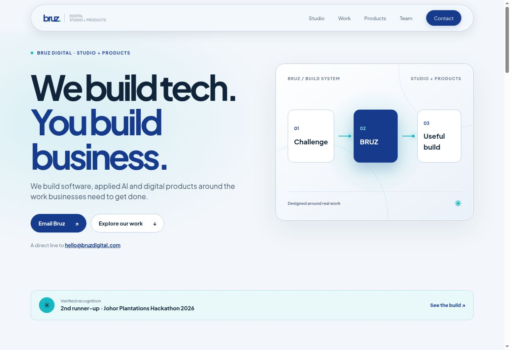
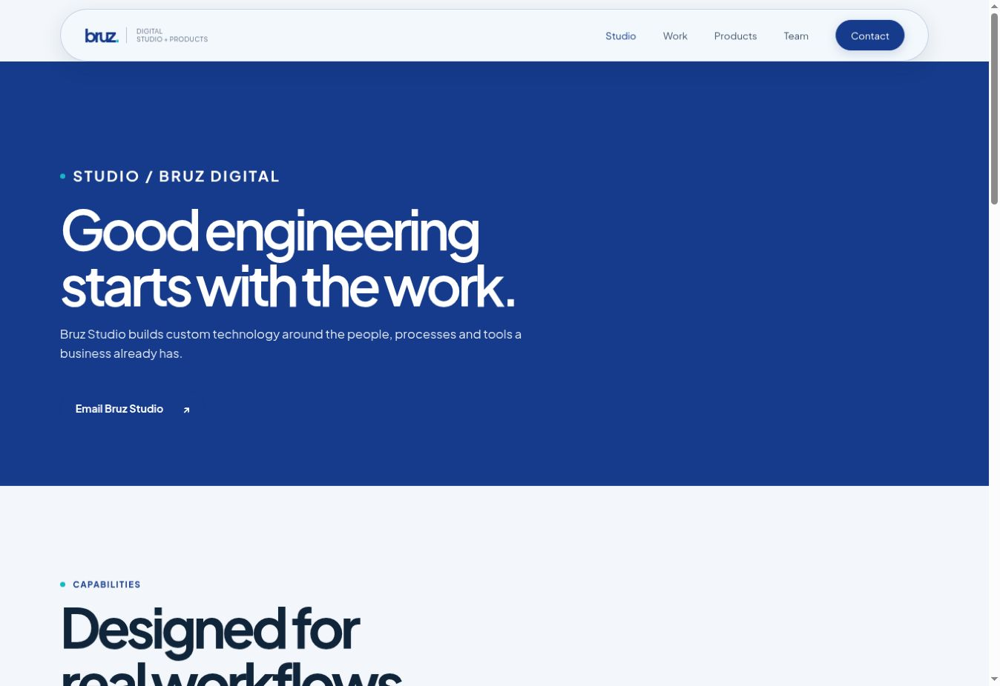
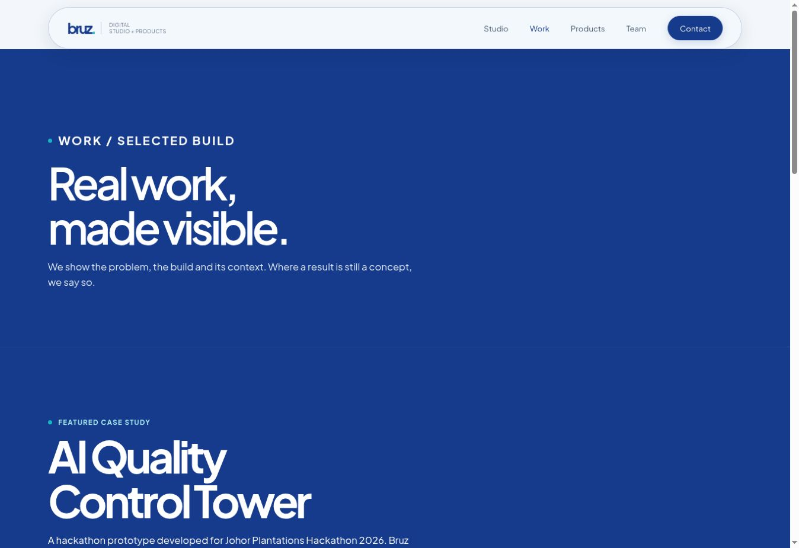
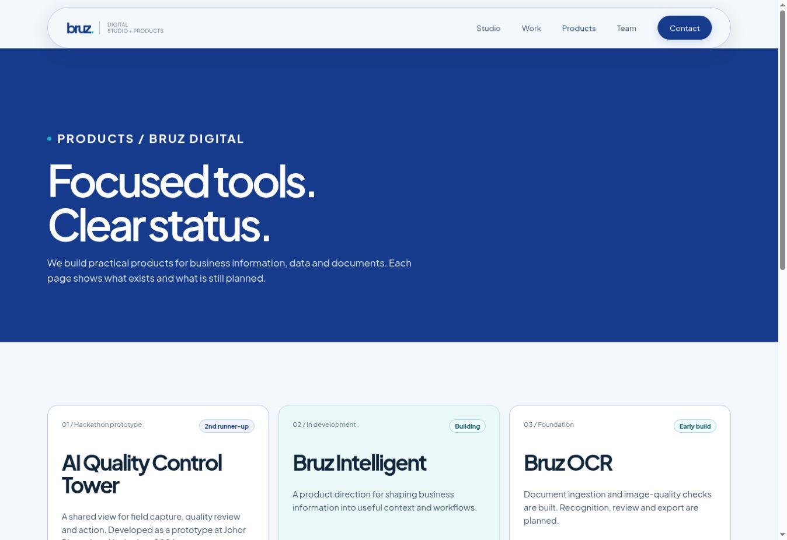
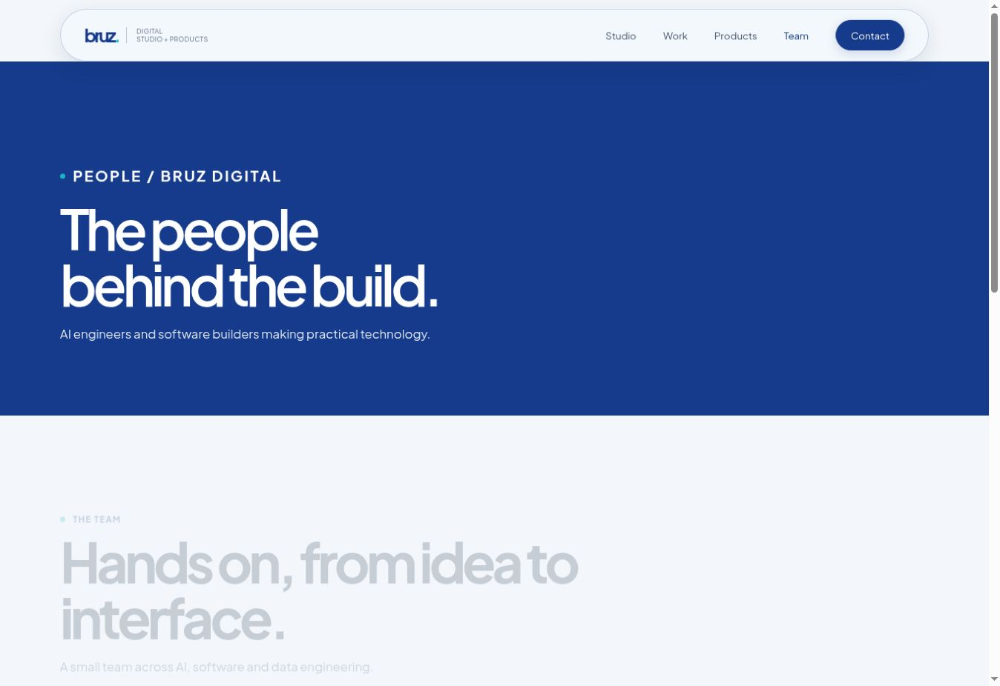
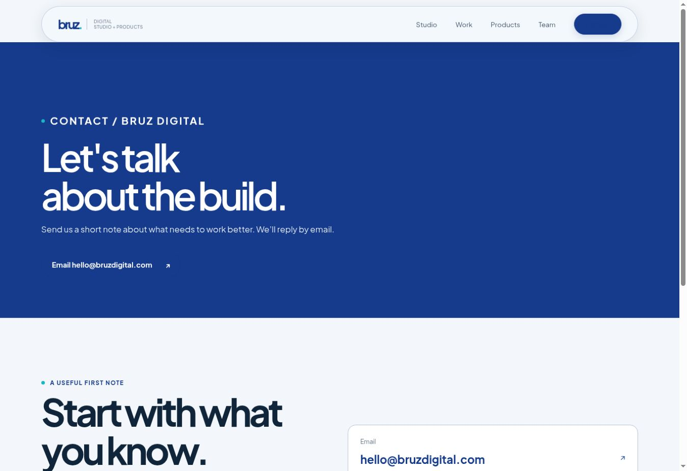
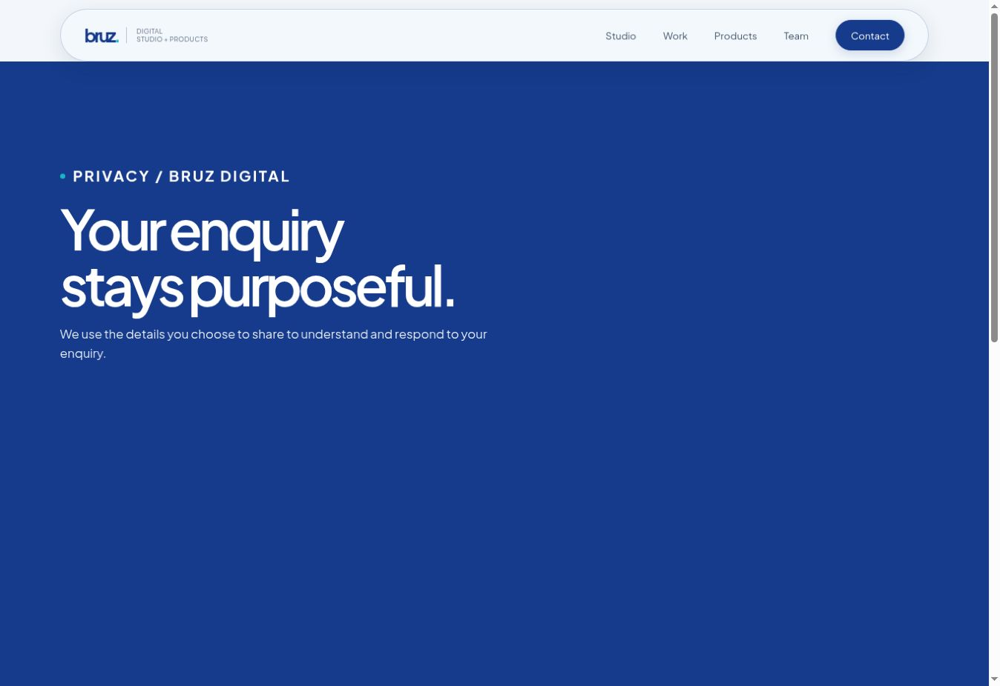
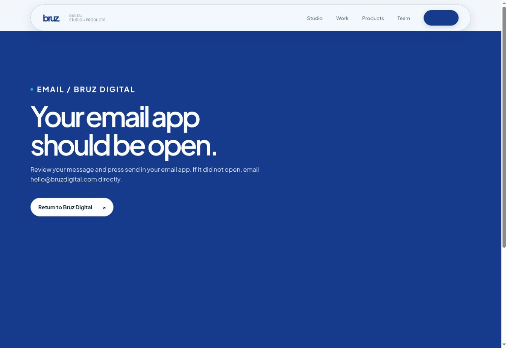
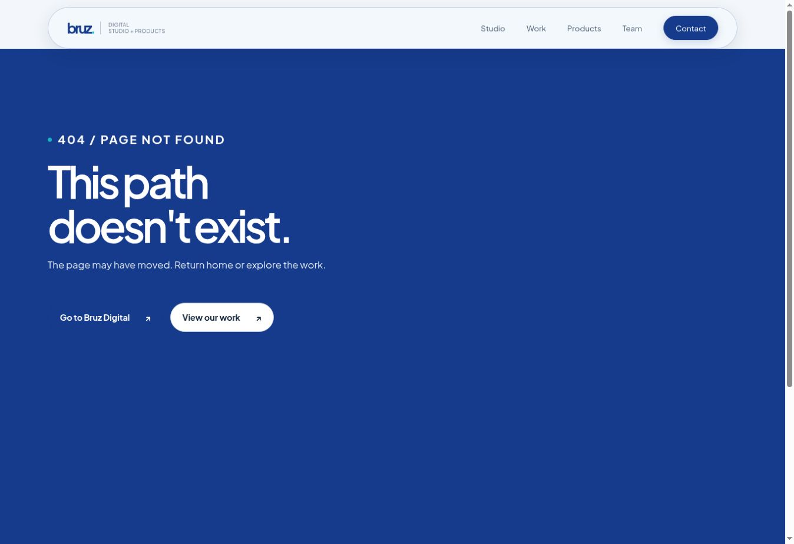

# Bruz Digital

**We build tech. You build business.** Bruz Digital presents its studio work, applied AI, digital products, team and a direct email route for new enquiries.

[View the live website](https://bruzdigital.sarvind.chatgpt.site/) · [Deployment notes](DEPLOYMENT.md)

## What we completed — 31 October 2026

- Rebuilt the site around the approved Signal Blue identity, Plus Jakarta Sans, a clearer studio and product story, and honest labels for prototype and in-development work.
- Added a sticky glass navigation bar with scroll progress, a redesigned footer, and a compact transparent B favicon for browser tabs.
- Updated the team listing so Sarvind is shown as an **AI Engineer**.
- Added a restrained hero entrance, scroll reveals, hover feedback, and an interactive **Capture → Review → Act** walkthrough for the illustrative AI Quality Control Tower prototype. Motion respects reduced-motion preferences.
- Widened the selected-work heading, filled its open area with a build-path preview, and tightened the gap above the home hero.
- Corrected inner-page hero contrast and included the Products page in the production bundle.

The Quality Control Tower is a hackathon prototype, with **2nd runner-up** recognition at Johor Plantations Hackathon 2026. Product stages on the site describe their current state; interface visuals are illustrative.

## Page screenshots

Desktop viewport captures of the published site, taken on 31 October 2026. Open an image for a larger view.

| Page | What it covers | Screenshot |
| --- | --- | --- |
| [Home](https://bruzdigital.sarvind.chatgpt.site/) | Studio, selected work, products, team and contact | [](docs/screenshots/bruz-home.jpg) |
| [Studio](https://bruzdigital.sarvind.chatgpt.site/services) | Custom software, applied AI and web work | [](docs/screenshots/bruz-studio.jpg) |
| [Work](https://bruzdigital.sarvind.chatgpt.site/projects) | Quality Control Tower case study | [](docs/screenshots/bruz-work.jpg) |
| [Products](https://bruzdigital.sarvind.chatgpt.site/products) | Product directions and their current stages | [](docs/screenshots/bruz-products.jpg) |
| [Team](https://bruzdigital.sarvind.chatgpt.site/team) | People and roles | [](docs/screenshots/bruz-team.jpg) |
| [Contact](https://bruzdigital.sarvind.chatgpt.site/contact) | Email-led project enquiries | [](docs/screenshots/bruz-contact.jpg) |
| [Privacy](https://bruzdigital.sarvind.chatgpt.site/privacy) | How email enquiries are handled | [](docs/screenshots/bruz-privacy.jpg) |
| [Email handoff](https://bruzdigital.sarvind.chatgpt.site/thanks) | Help after opening an email app | [](docs/screenshots/bruz-thanks.jpg) |
| [404](https://bruzdigital.sarvind.chatgpt.site/404) | Missing-page recovery | [](docs/screenshots/bruz-not-found.jpg) |

## Tech stack

| Layer | Technology |
| --- | --- |
| Pages | Semantic HTML5 generated by `tools/build_revamp_pages.py` |
| Styling and motion | CSS3 in `revamp.css`, including responsive layouts, transitions and reduced-motion rules |
| Interaction | Vanilla JavaScript in `revamp.js` for navigation, scroll effects and the prototype walkthrough |
| Typography and brand | Self-hosted Plus Jakarta Sans WOFF2 files and SVG brand assets in `assets/` |
| Build and audit | Python 3 standard library scripts in `tools/` |
| Hosting | Static `dist/` published through ChatGPT Sites; `netlify.toml` is also present for a Netlify deployment |
| Version control | GitHub, with ongoing work on `ahmad-branch` |

There is no JavaScript framework, package manager install, API server or database required to run this website. Contact links open the visitor's email app; the site does not submit an enquiry form.

## Run locally

From the repository root with Python 3 installed:

```bash
python tools/build_production.py
python tools/audit_production.py
python -m http.server 8766 --directory dist
```

Open `http://localhost:8766/`. Edit `tools/build_revamp_pages.py` for page content, `revamp.css` for styling, and `revamp.js` for behavior; regenerate the HTML with the build command. The `dist/` directory is the deployable output. See [deployment guidance](DEPLOYMENT.md) for more detail.

## Next steps

- Review the product descriptions and stages as actual builds evolve.
- Add real project screenshots and measurable outcomes when the team has approved material to share.
- Revisit mobile and desktop interactions with user feedback, especially the prototype walkthrough and contact path.
